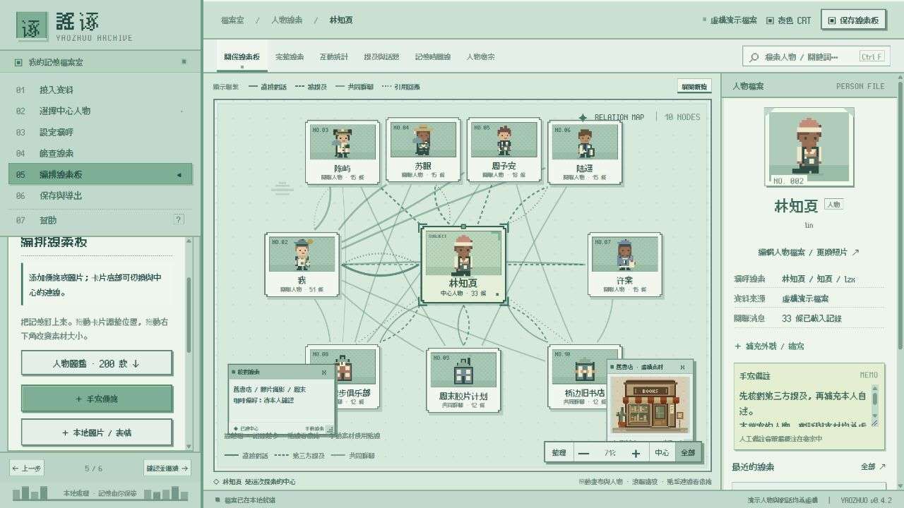
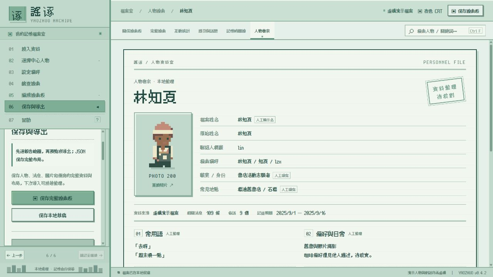
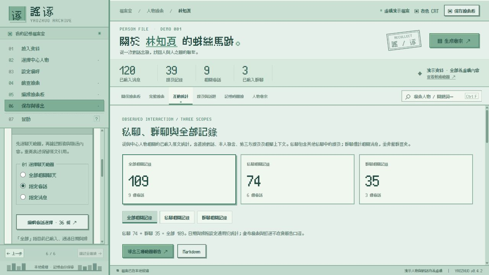
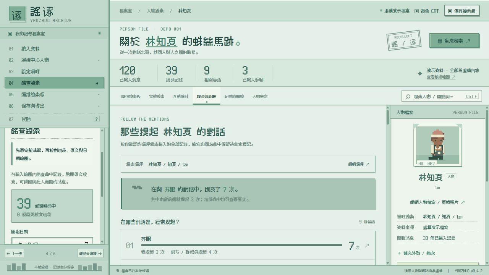
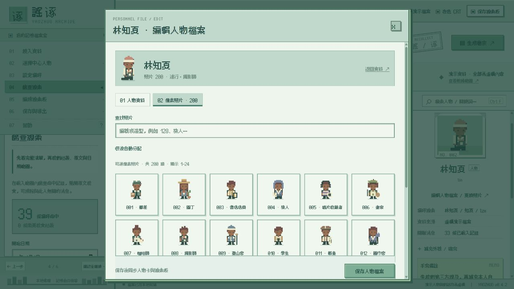
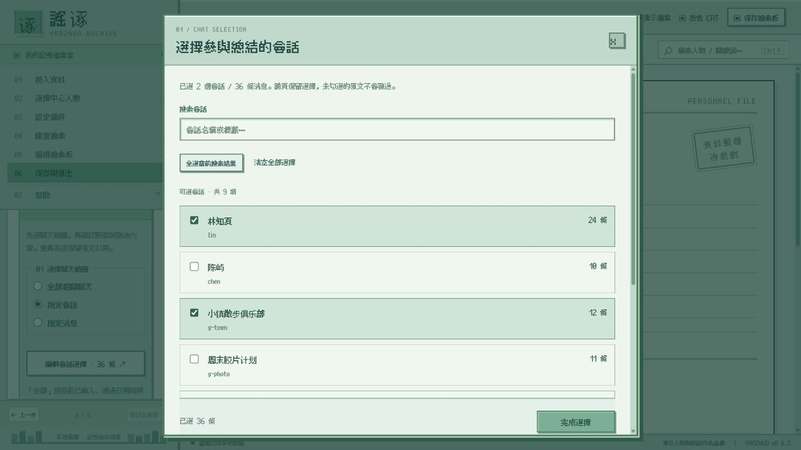

<p align="center">
  
</p>

<h1 align="center">謠诼</h1>
<p align="center"><em>"众女嫉余之蛾眉兮，谣诼谓余以善淫"</em></p>
<p align="center">把零散的对话，整理成可核对的人物档案。</p>
<p align="center">像素线索板 · 人物卷宗 · 聊天分析 · 本地资料</p>

<p align="center">
  <a href="#界面预览">界面预览</a> ·
  <a href="#主要功能">主要功能</a> ·
  <a href="#快速开始">快速开始</a> ·
  <a href="docs/謠诼-使用说明.md">使用说明</a>
</p>

謠诼是一个以人物为中心的本地线索工作台。选择一位联系人，从直接对话、其他会话中的提及、共同群聊和相关图片中整理线索，再将原文依据、人工备注与分析结果汇总成一份人物卷宗。

像素风格界面，支持拖动人物卡、图片和便签，自行编排关系线索板。

基于 [WeFlow](https://github.com/hicccc77/WeFlow) 开发。感谢🙏

## 界面预览
项目已通过本地验证。
以下人物、120 条聊天记录、群聊、便签和档案资料均为编写的虚构示例，不含真实微信资料。

### 关系线索板

以中心人物展开联系，区分直接对话、第三方提及、共同群聊和引用回复。便签、图片也可以手动连到中心人物，拖动后连线随位置变化。



### 人物卷宗

用档案卡整理像素照片、姓名、称呼、常用语、偏好和人物说明。支持编辑资料、添加自定义栏目；人工填写内容与原始记录分别保留。



### 分析与整理

| 互动统计 | 跨会话提及 |
| --- | --- |
| [](docs/images/03-statistics.jpg) | [](docs/images/04-mentions.jpg) |
| 分别查看全部、私聊、群聊的数量、发送比例、时段与会话总计。 | 找出哪些会话经常提到这个人，核对姓名、昵称、缩写及原文。 |

| 200 款像素照片 | AI 聊天范围选择 |
| --- | --- |
| [](docs/images/05-avatars.jpg) | [](docs/images/06-ai-scope.jpg) |
| 按编号和造型搜索，自行选择照片，并同步到人物卡与线索板。 | 选择全部相关聊天、指定会话或指定消息，再确认发送范围。 |

可导入 [截图使用的虚构示例档案](examples/fictional-caseboard.json)，体验人物资料、便签、图片与聊天分析。所有演示图片均为代码绘制的像素素材。

## 主要功能

| 模块 | 功能 |
| --- | --- |
| 本机资料 | 内置联系人与会话读取入口，尝试自动识别账号并验证密钥，也可导入 JSON 档案。 |
| 跨会话检索 | 通过姓名、昵称、备注与拼音缩写检索提及，保留原文和相邻上下文，支持人工排除无关记录。 |
| 关系线索板 | 展开人物与群聊，按作为依据的消息数量区分线宽，点击连线查看原文（Tip其实做下来不太像聊天分析了有点像六人定律启动器） |
| 自由编排 | 拖动人物、便签和图片，调整素材大小，建立或取消与中心人物的手动连线。 |
| 完整线索 | 分页列出人物、关系、相关原文、媒体及人工素材，支持搜索和核对。 |
| 互动分析 | 按全部、私聊、群聊分别统计消息数量、发送比例、类型、活跃时段、话题和各会话总计。 |
| 人物卷宗 | 编辑显示姓名、常用语、偏好和说明，添加自定义栏目，从 200 款像素人物中更换照片。 |
| AI 综述 | 接入兼容 Chat Completions 的服务，选择要发送的聊天，整理有原文依据的概括、偏好线索和常用表达。 |
| 保存与导出 | 本地草稿、可恢复的 JSON 线索板、带像素照片的 HTML 报告和 Markdown 卷宗。 |

## 快速开始

### 环境

- Node.js 24、npm。
- Windows：构建本机读取器需要 .NET Framework 4.x 编译器。
- macOS：构建本机读取器需要 Xcode Command Line Tools。

### 从源码运行

克隆或下载仓库，进入项目根目录后执行：

```sh
npm ci
npm run dev:desktop
```

仅预览界面可执行 `npm run dev`，默认端口3017。

首次使用可以点击「使用虚构演示档案」，也可以在「导入 JSON 资料 / 线索板」中载入 [示例档案](examples/fictional-caseboard.json)。

### 使用流程

1. **接入资料**：读取本机微信资料、导入 JSON，或使用虚构演示。
2. **选择中心人物**：确定这次要整理的对象。
3. **设置称呼**：核对姓名、昵称、旧备注与缩写。
4. **筛查线索**：查看提及和原文，设置日期，排除无关记录。
5. **编排线索板**：移动人物卡，添加图片和便签，整理手动连线。
6. **保存与导出**：编辑人物卷宗，选择报告范围，保存 JSON 或导出报告。

左侧「07 帮助」提供关系规则、统计口径和读取说明。详细操作见 [使用说明](docs/謠诼-使用说明.md)。

## AI 综述

在「06 保存与导出」中填写服务地址、模型名称及 API Key，选择参与总结的聊天，再确认发送。

- **全部相关聊天**：处理当前已载入、通过日期和排除筛选的相关消息。
- **指定会话**：只处理勾选会话中的相关消息。
- **指定消息**：搜索、分页并逐条勾选，跨页保留选择。

人工备注可单独选择发送。修改范围或服务后需要重新确认；总结和导出报告保留实际选取范围。归纳中的本人自述、重复线索、他人描述与不确定性分别标注，重要表述附原文引用。

处理速度取决于聊天记录数量，测试时大约需要5分钟处理100条。

## 数据与分析范围

资料读取只在本机副本中进行，原始数据库只读。数据库密钥、图片密钥和 AI API Key 不写入导出档案；外接 AI 在确认后将所选内容发送至填写的服务。JSON 和报告包含聊天原文及素材，应自行保管。

关系线表示记录支持的联系：共同群聊、第三方提及和引用回复不能直接证明两个人私下认识；目前不能准确确认真正的共同好友。线宽反映可见记录的频次，卡片位置由排版决定，均不代表亲密程度。

**姓名和缩写匹配需要人工核对** 不能可靠追踪「他、她、TA」等代词。未载入的会话不参与分析；偏好、饮品等常用表达的归纳也需要结合原文判断。

## 开发与打包
由于不可抗因素，release并未附带实际可安装版本。
GitHub Actions 提供 Windows 与 macOS 构建流程。Windows x64 / ARM64 已完成构建验证；macOS 已配置 Universal 构建但未经验证，欢迎提交issue。

版本变化见 [更新记录](CHANGELOG.md)。

## 许可

项目采用 [CC BY-NC-SA 4.0](LICENSE)。来源署名见 [来源与许可](README-WeFlow.md)，第三方字体遵循各自许可，见 [字体说明](public/caseboard/fonts/README.md)。
